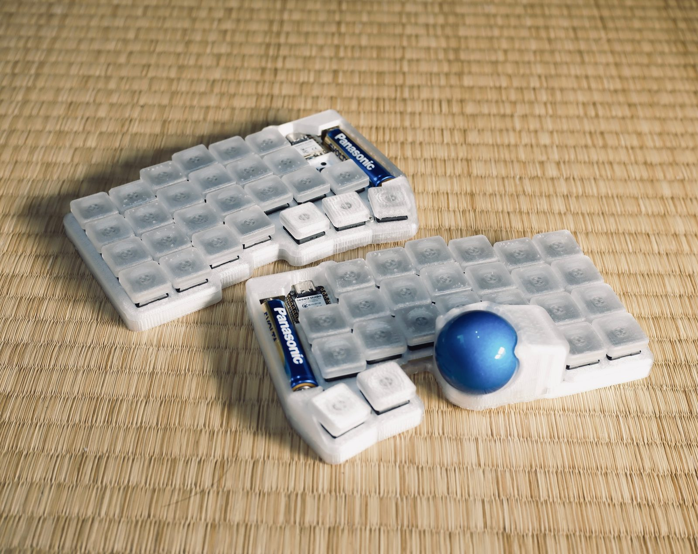
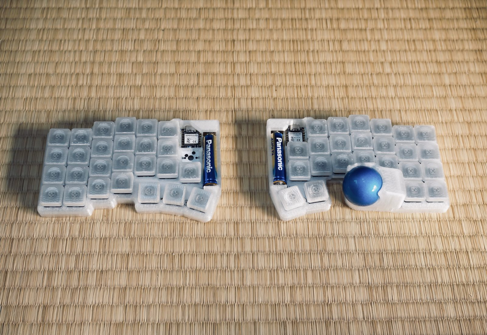

# LAMA



LAMA は、左右分割・トラックボール付きのワイヤレス自作キーボードです。[roBa](https://github.com/kumamuk-git/roBa)（[keyball](https://github.com/Yowkees/keyball/) に影響を受けた分割キーボード）を改造して作りました。ファームウェアは [ZMK](https://zmk.dev/) です。

## 特徴

- **左右分割・カラムスタッガード配列。** roBa の両端（小指側）に1列ずつキーを増やしている
- **右手に 25mm のトラックボール**（センサーは PMW3610）。ボールを動かすとマウスのレイヤーに自動で切り替わる
- **Bluetooth（BLE）で無線接続。** マイコンは左右とも Seeed Studio XIAO nRF52840 Plus
- **単3電池1本で動く。** 昇圧回路（TPS61221）で 3.3V にしている。電源スイッチ付き。電池の残量はファームウェアからは測れない
- 左手にロータリーエンコーダ（EC12）を付けられる（押し込みスイッチは未配線）
- **ZMK Studio に対応。** 右手を USB でつなぐと、ブラウザからキーマップを変えられる
- XIAO の RGB LED で Bluetooth の接続状態を表示する
- キーマップは Mac で使う前提（英数/かな、⌘、Mission Control、Spotlight など）



## キーマップ


| レイヤー | 入り方 | 内容 |
|---|---|---|
| BASE | — | 文字の入力 |
| FUNCTION | 右手親指の ⏎ を長押し | F1〜F13、明るさ・音楽・音量、スクリーンショット（⇧⌘4 / ⇧⌘5） |
| NUM | 左手親指の Space を長押し | テンキー（左手）と記号（右手） |
| ARROW | 左手親指の かな を長押し | 矢印・Home/End、タブの切り替え、ブラウザの戻る/進む |
| MOUSE | トラックボールを動かす（自動） | 右手の J/K/L が左/中/右クリック |
| SCROLL | I を長押し | トラックボールでスクロール |
| SYSTEM | 左手親指の 英数 を長押し | Bluetooth の接続先の切り替え・消去、ブートローダー |

英数・かな のキーは、タップすると BASE レイヤーに戻ってから英数・かなを送ります。キーマップの詳しい説明とピン配置は [doc/firmware.md](doc/firmware.md) にあります。

[doc/keymap.html](doc/keymap.html) は、ダウンロードしてブラウザで開くと、押したキーが光る配置図です（`python3 doc/keymap_gen.py` で keymap から作り直せます）。

## ファームウェア

### 入手する

push すると、GitHub Actions がファームウェアをビルドします（[.github/workflows/build.yml](.github/workflows/build.yml)）。Actions のページで最新の実行を開き、Artifacts からダウンロードすると、次の3つが入っています。

| ファイル | 書き込む先 |
|---|---|
| `LAMA_R-seeeduino_xiao_ble-zmk.uf2` | 右手（central。トラックボール側） |
| `LAMA_L-seeeduino_xiao_ble-zmk.uf2` | 左手（peripheral） |
| `settings_reset-seeeduino_xiao_ble-zmk.uf2` | 左右の接続をやり直したいとき（下記） |

自分のキーマップでビルドしたいときは、このリポジトリを fork して `config/LAMA.keymap` を書き換え、fork 先で Actions を有効にしてください。

### 書き込む

1. XIAO を USB でパソコンにつなぎ、リセットボタンをすばやく2回押す
2. USB ドライブが出てくるので、uf2 をそこへコピーする。コピーが終わると自動で再起動する
3. もう片方も同じように書き込む

左右がつながらなくなったときは、左右それぞれに `settings_reset` を書き込んでから、もう一度 `LAMA_L` / `LAMA_R` を書き込みます。パソコン側に残っている Bluetooth の登録も削除してください。

### キーマップを変える

- **ZMK Studio を使う:** 右手を USB でつなぎ、[ZMK Studio](https://zmk.studio/) で変える。変更はキーボードに保存され、ファームウェアのキーマップより優先される
- **ファイルを書き換える:** `config/LAMA.keymap` を編集して push する。Studio で保存したキーマップが残っていると反映されないので、そのときは Studio で「Restore Stock Settings」を実行する

キー配置図（`keymap-drawer/`）は、Actions の「Draw Keymap」を手動で実行すると作り直されます。

## ハードウェア

| ディレクトリ | 内容 |
|---|---|
| `pcb/v2/roBa_L/`・`pcb/v2/roBa_R/` | LAMA の基板（KiCad、左手・右手）。roBa の v2 基板をもとに、増設した列・XIAO nRF52840 Plus・昇圧回路を加えている |
| `pcb/` のそのほか | `pcb/v1/` は roBa の旧版の基板。PMW3610 のブレークアウト基板、エンコーダの延長基板、シンボルとフットプリントのライブラリ（`_kicad_symbols/`・`_kicad_footprints/`・`KiCADv6/`） |

組み立ての手順とケースは、roBa 本家の[ビルドガイド](https://github.com/kumamuk-git/roBa/blob/main/doc/v3/buildguide_v3.md)と[ケースのデータ](https://github.com/kumamuk-git/roBa/tree/main/case)を参考にしてください。LAMA で足した部品（増設した列のスイッチ、昇圧回路、単3電池の端子）は、このガイドには載っていません。

KiCad でライブラリを読むには、環境変数 `ROBA_FP`（`pcb/_kicad_footprints`）、`ROBA_SYMBOL`（`pcb/_kicad_symbols`）、`ROBA_V6_FP`（`pcb/KiCADv6/footprints.pretty`）、`ROBA_V6_SYM`（`pcb/KiCADv6`）を設定してください（KiCad の「設定 → パスの設定」）。

## リポジトリの構成

```
.
├── boards/shields/LAMA/   ZMK のシールド定義(ピン配置・物理レイアウト・左右の設定)
├── config/                キーマップ(LAMA.keymap)・物理レイアウト(LAMA.json)・west.yml
├── keymap-drawer/         キー配置図(LAMA.svg)
├── doc/keymap.html        押したキーが光るキー配置図(doc/keymap_gen.py で生成)
├── build.yaml             GitHub Actions でビルドする組み合わせ
├── pcb/                   基板(上記)
├── doc/                   ファームウェアの説明・写真
└── zephyr/module.yml      このリポジトリを ZMK のモジュールとして読ませる設定
```

## クレジット

- [roBa](https://github.com/kumamuk-git/roBa)（kumamuk-git）— LAMA のもとになったキーボード。LAMA の基板・ファームウェアの設定・フットプリントとシンボルのライブラリは roBa のものを改造している。組み立てとケースも roBa 本家の資料を参照
- [keyball](https://github.com/Yowkees/keyball/) — roBa が影響を受けたキーボード
- [zmk-config-roBa](https://github.com/kumamuk-git/zmk-config-roBa) / [zmk-pmw3610-driver](https://github.com/kumamuk-git/zmk-pmw3610-driver) — ZMK の設定とトラックボールのドライバ
- [zmk-rgbled-widget](https://github.com/caksoylar/zmk-rgbled-widget) — XIAO の LED で接続状態を表示する
- [keymap-drawer](https://github.com/caksoylar/keymap-drawer) — キー配置図の生成

## ライセンス

[GPLv3](LICENSE)。[roBa](https://github.com/kumamuk-git/roBa)（GPLv3）をもとにした派生プロジェクトです。

## English

LAMA is a wireless split keyboard with a 25 mm trackball, based on [roBa](https://github.com/kumamuk-git/roBa). It adds an extra pinky column on each side, has a power switch and an optional EC12 rotary encoder on the left half, runs [ZMK](https://zmk.dev/) on two Seeed Studio XIAO nRF52840 Plus boards, is powered by a single AA battery per half, and supports ZMK Studio. GitHub Actions builds the firmware on every push. See [doc/firmware.md](doc/firmware.md) for the pin assignments and keymap details. Licensed under GPLv3.
